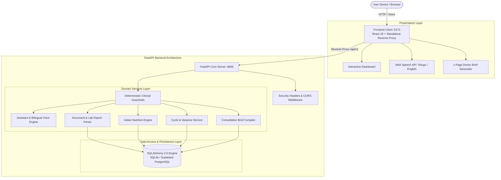

# 🌿 Health Saathi (PCOS Saathi) — AI-Powered Personal Health Copilot

<p align="center">
  <strong>Personalized Health Intelligence with Authentic Indian Nutrition & Telugu Voice PCOS Companion</strong>
</p>

<p align="center">
  
  
  
  
  
  
</p>

---

## 📌 Executive Summary & Problem Statement

**Polycystic Ovary Syndrome (PCOS)** affects over **1 in 5 Indian women of reproductive age**, yet faces significant challenges in everyday management:
* **Cultural Nutrition Mismatch**: Mainstream generic diet apps recommend Western meal plans (kale, quinoa, salmon) that ignore Indian dietary realities, vegetarian constraints, and regional grains (millets, lentils, ragi).
* **Language & Stigma Barriers**: Women across non-metro regions hesitate to seek reproductive health guidance due to stigma and lack of vernacular support.
* **Complex Medical Reports**: Laboratory panels with confusing acronyms (TSH, Fasting Insulin, LH:FSH ratio, AMH) cause unnecessary health anxiety.
* **Deceptive Rigid Predictions**: Period tracking apps deceive patients with exact date promises, neglecting the natural hormonal variance inherent to PCOS.

**Health Saathi** bridges these gaps as an **AI-powered personal health companion** engineered specifically for PCOS. Built with **strict medical safety guardrails**, it empowers women with culturally grounded nutrition, bilingual Telugu/English voice interaction, laboratory report literacy, adaptive cycle variance windows, and printable clinical consultation briefs for their doctors.

---

## 🌟 Key Features

| Feature | Description |
| :--- | :--- |
| 🗣️ **Bilingual Voice Companion** | Real-time speech-to-text and audio response in **Telugu (`te-IN`)** and **English (`en-IN`)**, answering questions about symptoms, lifestyle, and routines naturally without intimidation. |
| 🥗 **Authentic Indian PCOS Nutrition** | Curated database of regional Indian dishes (Pesarattu, Ragi Idli, Foxtail Millet/Korralu Khichdi, Kala Chana Chaat) with glycemic index (GI), protein/fibre metrics, and insulin-balancing guidance. |
| 📄 **Lab Report Explainer** | Automated extraction from blood test PDFs/images, providing plain-language explanations of biomarkers (TSH, Fasting Insulin, HbA1c, Testosterone, LH/FSH) with reference ranges and clinical notes. |
| 🩸 **Adaptive Menstrual Variance** | Cycle tracking designed with the *Uncertainty Principle*: provides realistic variance windows (e.g., 32–38 days) rather than false single-day certainty, reducing stress. |
| 📋 **Doctor Consultation Brief** | Generates a 1-page printable clinical brief summarizing cycle trends, flagged biomarkers, recent symptoms, and patient questions to maximize 10-minute doctor visits. |
| ⏰ **Smart Routine Reminders** | Daily adherence tracker for PCOS routines (Myo-Inositol, hydration, morning sunlight, fenugreek water, physical activity). |
| 🛡️ **Clinical Guardrails & Triage** | Strict non-diagnostic educational architecture. Deterministically intercepts red-flag symptoms (severe acute unilateral pain, hemorrhaging) with instant clinical referral protocols. |
| 👥 **Safe Peer Community** | Moderated peer discussions for lifestyle support, recipe sharing, and questions without medical misinformation. |

---

## 🏗️ System Architecture



---

## 🛠️ Technology Stack

| Layer | Technologies Used |
| :--- | :--- |
| **Frontend** | React 18, Vite, React Router DOM 6, Recharts, Lucide Icons, Custom CSS Design System |
| **Speech & Voice** | Web Speech API (`webkitSpeechRecognition` for `te-IN`/`en-IN`, `speechSynthesis`) |
| **Backend API** | Python 3.11, FastAPI 0.114, Uvicorn, Pydantic v2 Settings & Schemas, Starlette |
| **Database & ORM** | SQLAlchemy 2.0, Alembic (migrations), SQLite (local) / Supabase PostgreSQL (production) |
| **Document & OCR** | PyMuPDF (fitz), Pillow, Pytesseract OCR with fallback handling |
| **Security & Auth** | Argon2 / Passlib, Python-Jose (JWT tokens), OAuth2 password bearer |
| **Testing** | Pytest 8.3, Pytest-Asyncio, AnyIO (37 automated test suites) |

---

## 🚀 Quick Start Guide

### Prerequisites
* **Python 3.11+** installed
* (Optional) **Node.js 18+** if running Vite directly (or use the included standalone zero-dependency Python frontend server)

---

### Step 1: Backend Setup & Launch

1. Open PowerShell / Terminal and navigate to the backend folder:
   ```powershell
   cd backend
   ```

2. Activate the virtual environment:
   * **Windows PowerShell**:
     ```powershell
     .venv\Scripts\Activate.ps1
     ```
   * **macOS / Linux**:
     ```bash
     source .venv/bin/activate
     ```

3. Configure environment variables:
   * By default, `backend/.env` is configured for the local SQLite database (`health_saathi.db`).
   * To connect to **Supabase PostgreSQL**, update `DATABASE_URL` in `backend/.env`.

4. Start the FastAPI server:
   ```powershell
   uvicorn app.main:app --reload --port 8000
   ```
   * **Backend API**: `http://127.0.0.1:8000`
   * **Interactive Swagger UI**: `http://127.0.0.1:8000/docs`
   * **Health Check Endpoint**: `http://127.0.0.1:8000/health`

---

### Step 2: Frontend Setup & Launch

You can run the frontend using either method below:

#### Option A: Standalone Zero-Dependency Python Server (Recommended)
No `npm` or `node` installation needed. This serves the complete application bundle and automatically reverse-proxies API calls to the backend on port 8000:
```powershell
cd frontend
python serve_frontend.py
```
Open **`http://localhost:5173/`** in your browser.

#### Option B: Vite Development Server
If Node.js and npm are installed:
```powershell
cd frontend
npm install
npm run dev
```
Open **`http://localhost:5173/`** in your browser.

---

## 🔑 Pre-Seeded Demo Account

The synthetic demo database comes pre-seeded for immediate testing and presentation:

| Field | Demo Credential |
| :--- | :--- |
| **Email** | `priya@healthsaathi.in` |
| **Password** | `DemoUserPassword123!` *(or `Saathi@2026`)* |
| **Profile** | Priya Sharma (26 yo, vegetarian, 35-day cycle baseline) |
| **Pre-loaded Data** | 2 Lab reports with elevated TSH (4.85 mIU/L), 4 historical menstrual cycles, 10 authentic Indian PCOS recipes, care reminders, and community posts |

---

## 🛡️ Medical Safety & Ethical Guardrails

Health Saathi is engineered with explicit ethical and safety guardrails:

1. **Non-Diagnostic Educational Scope**:
   * The AI assistant and biomarker explainers strictly provide educational context and normal reference ranges.
   * The assistant never issues formal medical diagnoses, alters prescription medications, or replaces certified clinicians.
2. **Deterministic Emergency Crisis Interception**:
   * Critical red-flag keywords (severe unilateral abdominal pain, excessive hemorrhaging, fainting, ectopic pregnancy indicators) trigger immediate clinical emergency triage directives without waiting for LLM generation.
3. **Doctor Empowerment**:
   * Rather than attempting to replace consultations, the platform prepares patients with an objective, chronological health dossier for their healthcare provider.
4. **Transparent Uncertainty**:
   * Menstrual cycle predictions explicitly communicate variance ranges to prevent false security or stress.

---

## 🧪 Testing & Verification

The project includes comprehensive automated test coverage for API endpoints, medical guardrails, security authorization, and database compatibility:

```powershell
cd backend
pytest
```

**Test Suite Results (37 passed)**:
* `tests/test_assistant_guardrails.py` — Verifies red-flag emergency detection & non-diagnostic responses
* `tests/test_auth.py` — Authentication, password hashing, and token validation
* `tests/test_reports_biomarkers.py` — Lab report parsing, biomarker ranges, and OCR extraction
* `tests/test_nutrition.py` — Indian food database, glycemic index, and dietary filters
* `tests/test_cycles_symptoms.py` — Menstrual cycle logging and variance calculations
* `tests/test_reminders_consultations.py` — Care routines and doctor brief generation
* `tests/test_security_access.py` — Permission enforcement and route isolation
* `tests/test_postgres_compatibility.py` — Dual SQLite / PostgreSQL schema integrity

---

## 📁 Repository Structure

```text
hackathon/
├── frontend/                     # Frontend Application
│   ├── src/                      # React source components and pages
│   ├── preview.html              # Standalone production preview application
│   ├── serve_frontend.py         # Python reverse-proxy & preview server (:5173)
│   ├── serve.ps1                 # PowerShell HTTP listener
│   ├── launch_app.bat            # 1-click Windows launcher
│   └── package.json              # Node.js dependencies (React 18, Vite)
├── backend/                      # Python FastAPI REST API (:8000)
│   ├── app/
│   │   ├── api/                  # Domain API Routers (/api/v1/...)
│   │   ├── core/                 # Config, security, logging
│   │   ├── db/                   # SQLAlchemy engine, session, migrations
│   │   ├── models/               # Database ORM models
│   │   ├── repositories/         # Data access layer
│   │   ├── schemas/              # Pydantic validation schemas
│   │   ├── services/             # Business logic & AI pipelines
│   │   └── utils/                # Guardrails, emergency detectors, OCR
│   ├── tests/                    # Pytest test suite (37 tests)
│   ├── health_saathi.db          # Pre-seeded SQLite database
│   ├── alembic.ini               # Database migration configurations
│   └── requirements.txt          # Python dependencies
├── ai-ml/                        # AI & Multimodal Intelligence modules
├── database/                     # Seed scripts & synthetic data generators
├── docs/                         # Architecture, API guides, and schemas
└── README.md                     # Master project documentation
```

---

## 🌐 API Reference Overview

When the backend is running, visit **`http://localhost:8000/docs`** for interactive Swagger documentation.

* `GET /health` — Health check & guardrail status
* `POST /api/v1/auth/login` — OAuth2 token login
* `POST /api/v1/assistant/chat` — Multilingual Telugu/English educational consultation
* `POST /api/v1/assistant/voice` — Speech-to-text and voice generation endpoint
* `GET /api/v1/nutrition/meals` — Regional Indian PCOS meals and recipes
* `GET /api/v1/nutrition/plans` — Daily balanced meal suggestions
* `POST /api/v1/reports/upload` — Upload and parse laboratory PDF/image reports
* `GET /api/v1/biomarkers` — Extract and review biomarker trends
* `GET /api/v1/cycles` — Historical cycle tracking & variance estimates
* `POST /api/v1/consultations/brief` — Generate printable doctor consultation brief
* `GET /api/v1/reminders` — Medication & care routine tasks

---

## 📄 License & Disclaimer

* **Disclaimer**: *Health Saathi is an educational and supportive health companion. It is not a certified medical device and does not provide clinical diagnoses or prescriptive treatment. Always consult a qualified healthcare provider for medical advice.*
* **License**: MIT License — Built for Hackathon demonstration.
