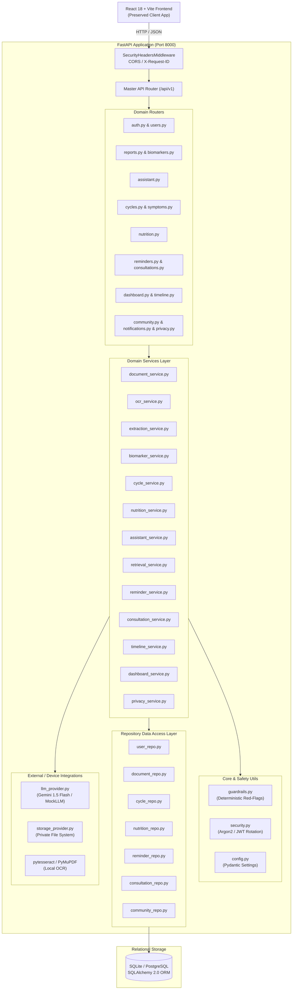
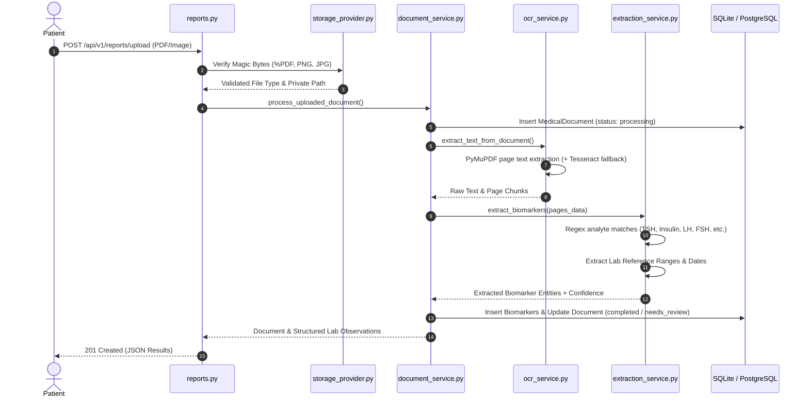
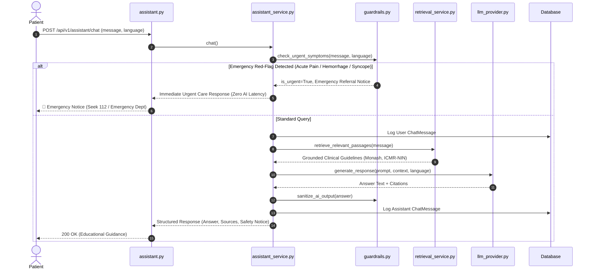

# Health Saathi (PCOS Saathi) — System Architecture

## 1. Executive Summary

**Health Saathi (PCOS Saathi)** is an AI-powered Personal Health Copilot engineered specifically for women navigating Polycystic Ovary Syndrome (PCOS). The system bridges clinical complexity, cultural Indian dietary realities, and patient self-advocacy through non-diagnostic educational guidance, laboratory report analysis, adaptive menstrual cycle variance estimation, and doctor visit preparation.

---

## 2. Layered Architecture

---

## 3. Core Pipelines

### 3.1 Medical Document Ingestion & Extraction Pipeline

### 3.2 Bilingual Assistant & Emergency Guardrail Flow

---

## 4. Key Security Controls

1. **Authentication & Authorization**:
   - Short-lived Access JWTs (30m) and Rotating Refresh JWTs (7d).
   - Resource ownership enforcement: all repositories query by `user_id = current_user.id`.
2. **Private File Isolation**:
   - Uploaded files are stored in `private_uploads/user_{id}/{uuid}.{ext}`.
   - Files are never accessible via public HTTP static mounts.
   - Binary signature (magic bytes) validation prevents extension spoofing.
3. **Medical Privacy & Right to Erasure**:
   - `/api/v1/privacy/export`: Complete JSON export of all patient data.
   - `/api/v1/privacy/purge`: Requires `DELETE MY HEALTH DATA` verification phrase and cascades removal across all 13 database tables and physically wipes disk storage.
