# Health Saathi Database Schema Reference

## 1. Entity-Relationship Diagram

```mermaid
erDiagram
    users ||--o| health_profiles : "has"
    users ||--o{ medical_documents : "uploads"
    medical_documents ||--o{ biomarkers : "contains"
    users ||--o{ biomarkers : "owns"
    users ||--o{ cycle_records : "logs"
    users ||--o{ symptom_records : "records"
    users ||--o{ meal_plans : "schedules"
    meal_plans ||--o{ meal_plan_items : "includes"
    meal_items ||--o{ meal_plan_items : "referenced_in"
    users ||--o{ care_reminders : "creates"
    care_reminders ||--o{ reminder_completions : "tracks"
    users ||--o{ conversations : "participates"
    conversations ||--o{ chat_messages : "contains"
    users ||--o{ consultation_briefs : "generates"
    users ||--o{ community_posts : "authors"
    community_posts ||--o{ community_replies : "receives"
    community_posts ||--o{ content_reports : "reported_by"
    users ||--o{ notifications : "receives"

    users {
        int id PK
        string email UK
        string hashed_password
        string full_name
        boolean is_active
        boolean is_verified
        boolean consent_given
        datetime created_at
        datetime updated_at
    }

    health_profiles {
        int id PK
        int user_id FK
        int age
        string diet_type
        int baseline_cycle_length
        int period_duration
        string wellness_goals
        string allergies
        string preferred_language
        string timezone
    }

    medical_documents {
        int id PK
        int user_id FK
        string file_name
        string file_type
        string file_path
        string category
        string processing_status
        text ocr_raw_text
        datetime upload_date
        string error_message
    }

    biomarkers {
        int id PK
        int user_id FK
        int document_id FK
        string test_name
        string observed_value
        float numeric_value
        string unit
        float reference_range_lower
        float reference_range_upper
        string reference_range_text
        string status
        date test_date
        float extraction_confidence
        int source_page
        boolean is_user_corrected
        text plain_explanation
    }

    cycle_records {
        int id PK
        int user_id FK
        date start_date
        date end_date
        int duration_days
        string flow_intensity
        text notes
        datetime created_at
    }

    symptom_records {
        int id PK
        int user_id FK
        date recorded_date
        string symptom_type
        string severity
        text notes
        datetime created_at
    }

    meal_items {
        int id PK
        string name
        string category
        string diet_type
        boolean is_budget_friendly
        string serving_size
        int approx_calories
        float protein_grams
        float fibre_grams
        text ingredients
        string nutrition_source
        text pcos_benefits
    }

    meal_plans {
        int id PK
        int user_id FK
        date plan_date
        datetime created_at
    }

    meal_plan_items {
        int id PK
        int meal_plan_id FK
        int meal_item_id FK
        string meal_slot
        float servings
    }

    care_reminders {
        int id PK
        int user_id FK
        string title
        string category
        string scheduled_time
        string timezone
        date start_date
        string recurrence
        text notes
        boolean is_active
        datetime created_at
    }

    reminder_completions {
        int id PK
        int reminder_id FK
        datetime scheduled_occurrence
        boolean is_completed
        datetime completed_at
        datetime snoozed_until
    }

    conversations {
        int id PK
        int user_id FK
        string language
        datetime created_at
    }

    chat_messages {
        int id PK
        int conversation_id FK
        string role
        text content
        datetime created_at
    }

    consultation_briefs {
        int id PK
        int user_id FK
        text primary_concerns
        text symptoms_summary
        text lab_flags_summary
        text prioritized_questions
        datetime created_at
    }

    community_posts {
        int id PK
        int user_id FK
        string pseudonym
        string title
        text content
        string tags
        string status
        datetime created_at
    }

    community_replies {
        int id PK
        int post_id FK
        int user_id FK
        string pseudonym
        text content
        string status
        datetime created_at
    }

    content_reports {
        int id PK
        int reporter_id FK
        int post_id FK
        string reason
        string status
        datetime created_at
    }

    notifications {
        int id PK
        int user_id FK
        string title
        string message
        string notification_type
        boolean is_read
        datetime created_at
    }
```

---

## 2. Table Specifications

### `users`
* `id`: Integer, Primary Key, Auto-increment
* `email`: String(255), Unique, Indexed, Case-normalized
* `hashed_password`: String(255), Argon2/bcrypt hash
* `full_name`: String(150), Patient name
* `is_active`: Boolean, default `True`
* `is_verified`: Boolean, default `False`
* `consent_given`: Boolean, default `True`
* `created_at`: DateTime UTC
* `updated_at`: DateTime UTC

### `health_profiles`
* `id`: Integer, Primary Key
* `user_id`: Integer, Foreign Key (`users.id`, `ON DELETE CASCADE`), Unique
* `age`: Integer (optional)
* `diet_type`: String(50), default `'veg'` (`veg`, `egg`, `non-veg`)
* `baseline_cycle_length`: Integer (typical cycle days, e.g., 34)
* `period_duration`: Integer (bleeding days, e.g., 5)
* `wellness_goals`: Text
* `allergies`: Text
* `preferred_language`: String(10), default `'en'` (`en`, `te`)
* `timezone`: String(50), default `'Asia/Kolkata'`

### `medical_documents`
* `id`: Integer, Primary Key
* `user_id`: Integer, Foreign Key (`users.id`, `ON DELETE CASCADE`), Indexed
* `file_name`: String(255), Original filename
* `file_type`: String(50), Validated format (`pdf`, `png`, `jpg`)
* `file_path`: String(500), Isolated filesystem path in private storage
* `category`: String(100), default `'lab_report'`
* `processing_status`: String(50), `'uploaded'`, `'processing'`, `'needs_review'`, `'completed'`, `'failed'`
* `ocr_raw_text`: Text, extracted text
* `upload_date`: DateTime UTC
* `error_message`: String(500), sanitized processing error notice

### `biomarkers`
* `id`: Integer, Primary Key
* `user_id`: Integer, Foreign Key (`users.id`, `ON DELETE CASCADE`), Indexed
* `document_id`: Integer, Foreign Key (`medical_documents.id`, `ON DELETE SET NULL`)
* `test_name`: String(150), Canonical analyte name (e.g., TSH, Fasting Insulin, LH, FSH, Testosterone)
* `observed_value`: String(100), Extracted verbatim observation string
* `numeric_value`: Float (parsed numeric quantity)
* `unit`: String(50), e.g. `mIU/L`, `uIU/mL`, `ng/dL`
* `reference_range_lower`: Float (from lab report)
* `reference_range_upper`: Float (from lab report)
* `reference_range_text`: String(150), e.g., `"0.4 - 4.5 mIU/L"`
* `status`: String(50), `'normal'`, `'elevated'`, `'low'`, `'needs_review'`
* `test_date`: Date (collection date)
* `extraction_confidence`: Float (0.0 to 1.0)
* `source_page`: Integer (PDF page number)
* `is_user_corrected`: Boolean, default `False`
* `plain_explanation`: Text (non-diagnostic patient-friendly summary)

---

## 3. Data Integrity & Migration Strategy

* **Production Migrations**: Executed through Alembic revision `001_initial_schema.py`.
* **Zero Fabrication Guarantee**: Missing lab reference intervals are never fabricated with arbitrary numbers; marked with `status='needs_review'` and `confidence < 0.8`.
* **Right to Erasure (Purge)**: Handled via foreign key cascade rules and `privacy_service.purge_user_data()` which cleans up all associated records and removes physical files from private disk storage.
